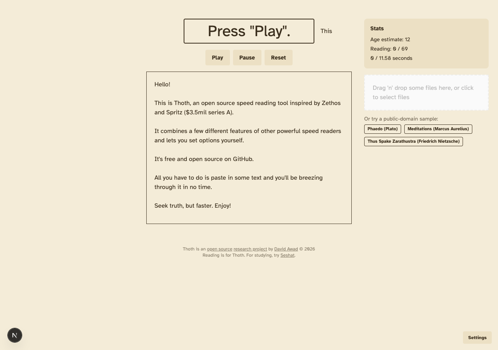
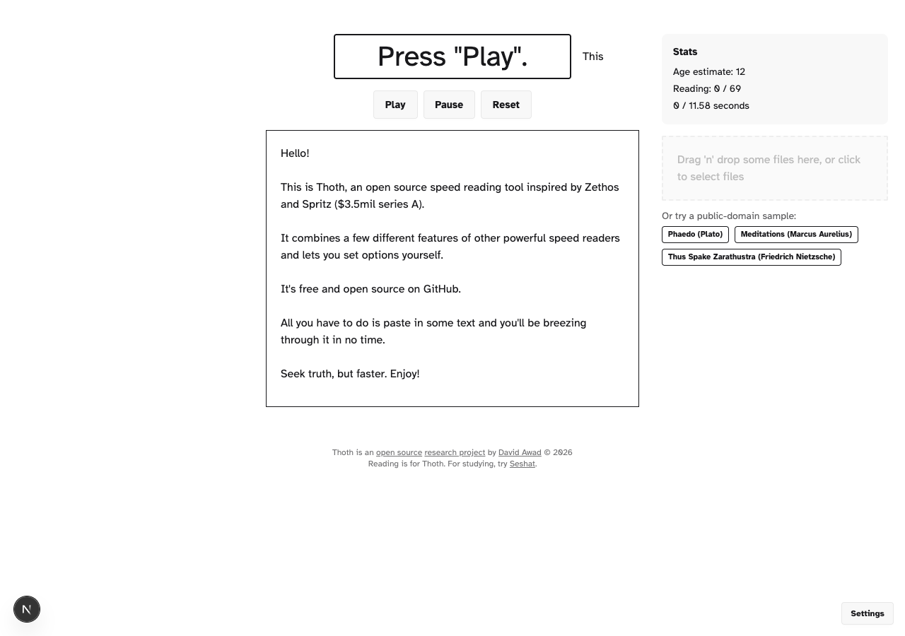
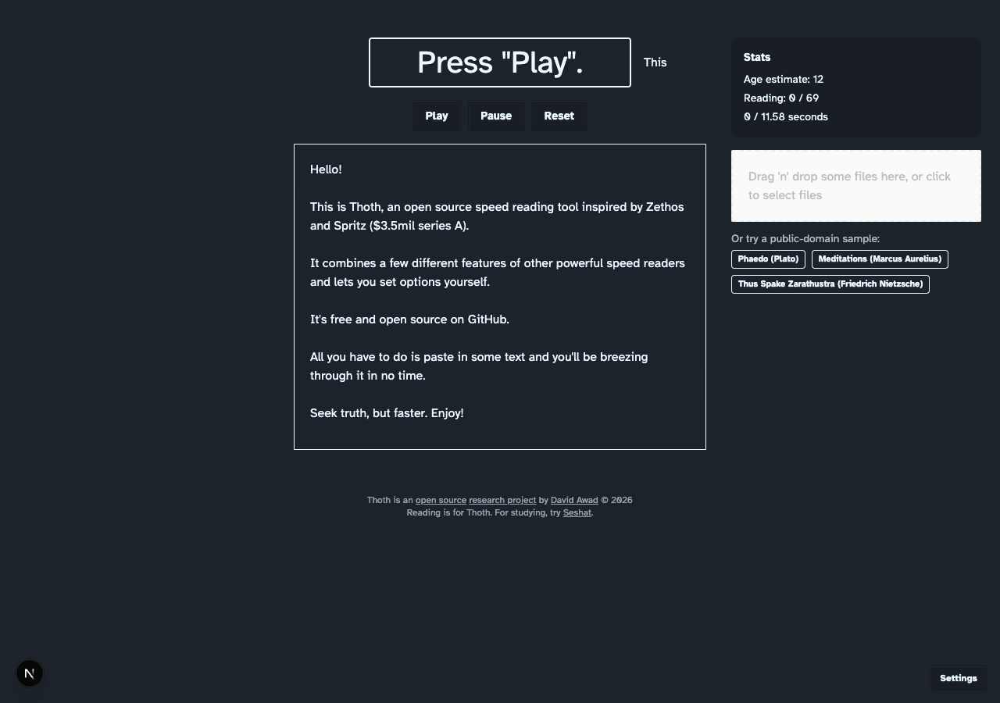

# Thoth

### Seek truth, but faster.

Thoth is a speed reading tool that enables you to read PDF's and text selections faster than you otherwise would.
It contains a bevy of settings and features for customizing your experience.

See my presentation here for a walkthrough : https://www.youtube.com/watch?v=iyLc0WiCYn4

Thoth is hosted online @ https://davidawad.gitlab.io/thoth/

| Light                                                                           | Dark                                                                          |
| ------------------------------------------------------------------------------- | ----------------------------------------------------------------------------- |
|  |  |

Looking to study instead? Try [Seshat](https://github.com/davidawad/Seshat).

## Dynamic pacing

Dynamic pacing adjusts each word's display time using a weighted blend of
word-level and sentence-level readability and language-complexity scorers. A
score above 1 lengthens dwell time; a score below 1 shortens it. The result is
clamped and smoothed before it is applied to the selected words-per-minute
baseline.

The scorer weights in Settings cover these signals:

- `wordDifficulty`: syllable count and Dale–Chall/Spache dictionary familiarity.
- `fleschReadingEase`, `gunningFog`, `smog`, `colemanLiau`,
  `automatedReadability`, `daleChall`, and `spache`: sentence-level readability
  formulas.
- `lexicalDensity`: the sentence's proportion of content words.
- `wordRarity`: an approximate word-frequency signal.
- `clauseDepth`: a sentence-level estimate based on subordinate conjunctions,
  commas, and sentence length.
- `wordLength`: word length and syllable count, with a sentence-level average.

In Settings, enable or disable dynamic pacing and adjust each scorer's weight,
the minimum and maximum multiplier, the curve around the baseline, and
smoothing between consecutive words. These settings are saved in
`localStorage`. Large landing-reader texts and book chapters precompute pacing
in a Web Worker, with a chunked fallback and a cache keyed by text, sentence
boundaries, enabled state, and pacing settings. Cached multipliers use the same
word and sentence scoring as `wordDisplayTime`.
Disabling dynamic pacing turns off the configurable scorers; the existing
`wordDifficulty` adjustment remains active. Playback computes pacing as each
word is scheduled.

### Research context and future work

The [Thoth research paper](http://arxiv.org/abs/1908.01699) identifies fixed
unfamiliar-word timing as a limitation in §8.1 and comparing dictionaries as
future work in §8.2. Dynamic pacing expands the timing heuristic with graduated
word and sentence signals, and exposes the readability scorers as adjustable
weights. These are heuristic estimates, not a validated model of an individual
reader's comprehension. The paper's user study proposal in §8.3 remains open;
the scorer weights and dictionary choices still need evaluation with readers.
The chunked 100,000-word fallback benchmark averages 743 ms on the development
container (`pnpm exec vitest bench --run bench/pacingPrecompute.bench.ts`).

This project is a proof of concept implementing Thoth as described in [this research paper](http://arxiv.org/abs/1908.01699)

## Available Scripts

The super short version

### `yarn install && yarn start`

In the project directory, you can run:

### `npm start`

Runs the app in the development mode. 
Open [http://localhost:4817](http://localhost:4817) to view it in the browser.

The page will reload if you make edits. 
You will also see any lint errors in the console.

### `npm test`

Launches the test runner in the interactive watch mode. 
See the section about [running tests](https://facebook.github.io/create-react-app/docs/running-tests) for more information.

### `npm run build`

Builds the app for production to the `build` folder. 
It correctly bundles React in production mode and optimizes the build for the best performance.

The build is minified and the filenames include the hashes. 
Your app is ready to be deployed!

See the section about [deployment](https://facebook.github.io/create-react-app/docs/deployment) for more information.

### Deployment

This section has moved here: https://facebook.github.io/create-react-app/docs/deployment

### notes on dockerfile

https://medium.com/@shakyShane/lets-talk-about-docker-artifacts-27454560384f

### Images used with attribution from freepik

https://www.freepik.com/free-vector/egypt-symbols-gods-collection_2857150.htm

## Related Projects

- [write-music](https://github.com/wooorm/write-music)
- [common-words](https://github.com/wooorm/common-words)
- [short-words](https://github.com/wooorm/short-words)
